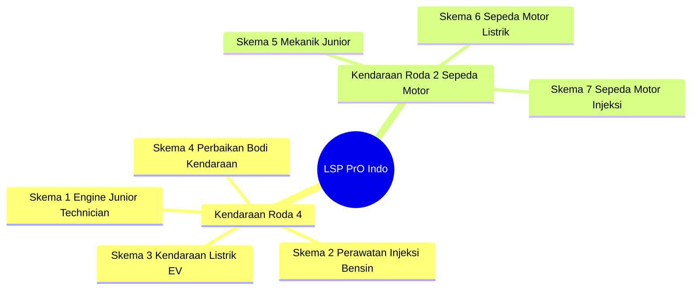
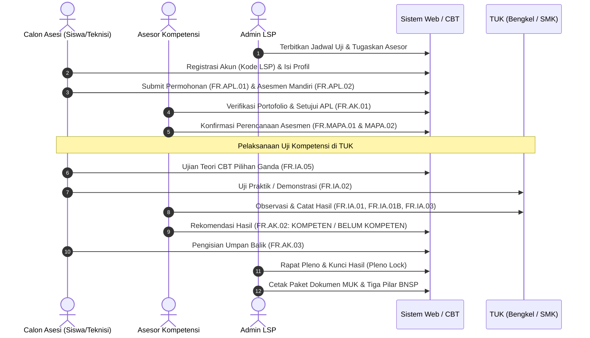

# LAPORAN KOMPREHENSIF: PROFIL, OPERASIONAL, DAN DOKUMEN MUK LSP PrO INDO

Laporan ini disusun berdasarkan investigasi mendalam terhadap:
1. Repositori dokumen master: `C:\Users\IRHAM\Documents\codes\lsp-proindo-system2\public\all-document-lsp-ProIndo` (dan salinannya di `lsp-proindo-new`).
2. Situs web resmi: [www.lspproindo.id](https://www.lspproindo.id).
3. Kode sumber sistem informasi manajemen sertifikasi (`lsp-proindo-system` dan `lsp-proindo-system2`).

---

## 1. Identitas & Profil Lembaga: Apa itu LSP PrO Indo?

| Parameter | Detail Informasi |
|---|---|
| **Nama Lembaga** | **LSP PrO Indo** (Lembaga Sertifikasi Profesi Praktisi Otomotif Indonesia) |
| **Bentuk Badan Hukum** | Lembaga Sertifikasi Profesi Pihak Ketiga (LSP-P3) / PT |
| **Lisensi & Akreditasi** | Berlisensi resmi dari **BNSP (Badan Nasional Sertifikasi Profesi)**, Republik Indonesia |
| **Situs Web Resmi** | [https://www.lspproindo.id/](https://www.lspproindo.id/) |
| **Kantor Pusat** | Ruko Blessing Center, Jl. Siput Raya No. 38, Kayuringin Jaya, Bekasi Selatan, Kota Bekasi, Jawa Barat 17144 |
| **Kontak Resmi** | WhatsApp: `0812-8557-7080` \| Email: `lsp.proindo@gmail.com` / `info@lsp-proindo.or.id` |
| **Manajemen Teknis** | Manager Sertifikasi: Karyanto |

### Visi & Misi Lembaga
- **Visi:** Menjadi Lembaga Sertifikasi Profesi terdepan dalam memastikan kompetensi SDM bidang Otomotif yang diakui secara nasional maupun internasional.
- **Misi:**
  1. Melaksanakan sertifikasi profesi secara objektif, independen, dan akuntabel.
  2. Melakukan peningkatan dan pemeliharaan standar kompetensi SDM otomotif.
  3. Mengembangkan sarana dan prasarana berbasis sistem teknologi informasi LSP.
  4. Mengembangkan skema dan materi uji kompetensi terkini sesuai dinamika industri.

### Nilai Tambah & Keunggulan Utama
1. **Lisensi Resmi BNSP**: Sertifikat kompetensi diterbitkan berlogo Garuda Emas, berlaku secara legal di seluruh Indonesia dan memiliki kesetaraan di tingkat regional (ASEAN MRA).
2. **Asesor Praktisi Industri**: Menggunakan asesor bersertifikat BNSP yang berlatar belakang praktisi bengkel, perakitan, dan industri otomotif riil.
3. **Kemitraan Luas dengan SMK & Industri**: Bermitra dengan SMK-SMK di berbagai daerah (sebagai Tempat Uji Kompetensi / TUK) dan jejaring bengkel/manufaktur untuk serapan kerja lulusan.
4. **Cakupan Teknologi Konvensional hingga EV**: Mengakomodasi teknologi mesin bensin konvensional, injeksi modern, hingga kendaraan ramah lingkungan (*Electric Vehicles*).

---

## 2. Apa yang Dilakukan: 7 Skema Sertifikasi Kompetensi

Berdasarkan dokumen master pada direktori `public/all-document-lsp-ProIndo`, LSP PrO Indo menyelenggarakan sertifikasi pada **7 skema kompetensi**:

### Detail Rinci Skema Sertifikasi:
1. **Skema 1: Engine Junior Technician (Okupasi)**
   - *Fokus:* Pemeliharaan dasar dan servis mekanikal mesin kendaraan roda empat ringan.
   - *Kelayakan:* Lulusan SMK Otomotif, siswa SMK aktif yang telah menuntaskan Prakerin, atau lulusan pelatihan terakreditasi.
2. **Skema 2: Klaster Maintenance Gasoline Engine Injection System**
   - *Fokus:* Perawatan, diagnosa sensor, aktuator, dan injeksi bahan bakar bensin kendaraan roda empat.
   - *Kelayakan:* Siswa SMK/lulusan kursus atau teknisi bengkel dengan pengalaman kerja minimal 1 tahun.
3. **Skema 3: Periodical Maintenance Electrified Vehicles (Mobil Listrik / EV)**
   - *Fokus:* Servis berkala kendaraan listrik, keselamatan kerja tegangan tinggi (K3 EV & 5R), pembacaan Electrical Wiring Diagram (EWD), dan pemeliharaan battery pack/motor traksi.
   - *Kelayakan:* Lulusan pelatihan EV terakreditasi atau teknisi dengan pengalaman kerja minimal 1 tahun di bidang kendaraan listrik.
4. **Skema 4: Memperbaiki Panel Bodi Kendaraan (Klaster)**
   - *Fokus:* Analisis kerusakan bodi, pelepasan/pemasangan kelistrikan bodi, perbaikan pelat bodi menggunakan metode palu dan dolly (hammer & dolly).
   - *Kelayakan:* Siswa jurusan bodi otomotif/teknisi bodi dengan pengalaman minimal 1 tahun.
5. **Skema 5: Mekanik Junior (Okupasi)**
   - *Fokus:* Standar dasar mekanik sepeda motor dan kendaraan umum, perawatan sistem pelumasan, transmisi, sasis, dan sistem sinyal kelistrikan.
   - *Kelayakan:* Siswa/lulusan SMK Otomotif dan teknisi magang.
6. **Skema 6: Servis Sepeda Motor Listrik (Klaster)**
   - *Fokus:* Penanganan kelistrikan sepeda motor listrik, baterai lithium/lead-acid pack, kontroler, motor penggerak BLDC, dan prosedur K3 baterai.
   - *Kelayakan:* Teknisi dengan pelatihan kendaraan listrik roda dua atau pengalaman kerja relevan.
7. **Skema 7: Klaster Servis Sepeda Motor Injeksi**
   - *Fokus:* Perawatan sistem injeksi sepeda motor, pembersihan injektor, kalibrasi sensor (TPS, O2, EOT/ECT), dan reset ECU/ECM.
   - *Kelayakan:* Siswa SMK kompetensi keahlian Teknik Bisnis Sepeda Motor (TBSM) atau mekanik AHASS/bengkel resmi/umum.

---

## 3. Bagaimana Cara Kerjanya: Alur Operasional Asesmen (Workflow)

Pelaksanaan sertifikasi mengikuti standar baku BNSP dengan adaptasi operasional lapangan di SMK/TUK:

### Penjelasan Tahapan Kerja:
1. **Pendaftaran (Gatekeeper & Wizard APL):**
   - Calon asesi mendaftar ke portal web dengan kode khusus (`LSP-PROINDO-2026`).
   - Asesi mengisi data diri dan mengajukan skema melalui form **FR.APL.01** serta asesmen mandiri **FR.APL.02**.
2. **Pra-Asesmen & Verifikasi:**
   - Asesor memeriksa kesiapan bukti pendukung. Jika memenuhi syarat, status peserta disahkan dan persetujuan kerahasiaan (**FR.AK.01**) ditegakkan.
3. **Pelaksanaan Uji (Dual Mode: CBT & Praktik Langsung):**
   - **Teori / CBT Online:** Dilakukan melalui platform web (**FR.IA.05.A**), sistem otomatis menilai jawaban dengan passing grade 75%.
   - **Praktik & Observasi Langsung:** Dilaksanakan secara tatap muka di bengkel TUK/SMK. Asesi melakukan demonstrasi pekerjaan (**FR.IA.02**), dan asesor mencatat daftar periksa (**FR.IA.01**), lembar kerja (**FR.IA.01.B**), serta tanya jawab lisan (**FR.IA.03**).
4. **Penetapan Rekomendasi & Pleno:**
   - Asesor memberikan rekomendasi final pada **FR.AK.02**: *Kompeten (K)* atau *Belum Kompeten (BK)*.
   - Admin LSP melakukan penguncian status (**Pleno Lock**).
   - Seluruh riwayat formulir diabadikan (*snapshot*) untuk kebutuhan pelaporan audit lisensi BNSP.

---

## 4. Struktur Inventaris Dokumen MUK (Folder: `all-document-lsp-ProIndo`)

Folder `public/all-document-lsp-ProIndo` berisi repositori acuan instrumen Materi Uji Kompetensi (MUK). Di dalamnya terdapat **18 keluarga formulir standar BNSP**:

| Kode Instrumen | Nama Dokumen Resmi | Fungsi & Peruntukan |
|---|---|---|
| **Cover & 0** | Perangkat Cover MUK & Daftar Periksa | Cover bundel dokumen dan checklist verifikasi kelengkapan berkas skema |
| **FR.APL.01** | Permohonan Sertifikasi Kompetensi | Formulir pendaftaran resmi berisi identitas asesi, data pekerjaan, dan permohonan skema |
| **FR.APL.02** | Asesmen Mandiri | Pengakuan kesiapan mandiri peserta pada tiap Elemen dan Kriteria Unjuk Kerja (KUK) |
| **FR.MAPA.01** | Merencanakan Aktivitas dan Proses Asesmen | Rencana pendekatan asesmen, identifikasi bukti, kontekstualisasi, dan aturan bukti |
| **FR.MAPA.02** | Peta Instrumen Asesmen | Matriks pemetaan unit kompetensi terhadap instrumen uji (CL, TPD, PMO, DPT) |
| **FR.AK.01** | Persetujuan Asesmen dan Kerahasiaan | Akad kesepakatan jadwal asesmen, kerahasiaan materi, dan hak banding asesi |
| **FR.AK.02** | Rekaman Asesmen Kompetensi | Formulir rekapitulasi penilaian akhir asesor dengan rekomendasi (K / BK) |
| **FR.AK.03** | Umpan Balik dan Catatan Asesmen | Kuesioner evaluasi proses asesmen yang diisi oleh asesi |
| **FR.AK.04** | Formulir Banding Asesmen | Formulir pengajuan sanggahan asesi jika tidak puas terhadap keputusan asesor |
| **FR.AK.05** | Formulir Laporan Asesmen | Laporan komprehensif pelaksanaan asesmen oleh asesor kepada LSP |
| **FR.AK.06** | Meninjau Proses Asesmen | Lembar review perbaikan mutu proses pelaksanaan asesmen |
| **FR.AK.07** | Ceklis Penyesuaian yang Wajar | Penyesuaian asesmen bagi asesi berkebutuhan khusus/alasan khusus |
| **FR.IA.01** | Ceklis Observasi Aktivitas Praktik (CL) | Daftar periksa observasi tindakan langsung saat praktik di bengkel |
| **FR.IA.01.B** | Lembar Kerja / Report Sheet | Formulir pencatatan hasil pengukuran/spesifikasi teknis asesi saat demonstrasi |
| **FR.IA.02** | Tugas Praktik Demonstrasi (TPD) | Soal panduan tugas instruksi praktik yang harus dikerjakan asesi |
| **FR.IA.03** | Pertanyaan Mendukung Observasi (PMO) | Soal tanya-jawab lisan asesor untuk mengklarifikasi pemahaman asesi |
| **FR.IA.05.A** | Pertanyaan Tertulis Pilihan Ganda (DPT) | Bank naskah soal ujian tulis teori pilihan ganda |
| **FR.IA.05.B** | Kunci Jawaban Soal Pilihan Ganda | Lembar kunci jawaban acuan penilaian |
| **FR.IA.05.C** | Lembar Jawaban Pilihan Ganda | Lembar jawaban peserta ujian tertulis |
| **Tiga Pilar** | Berita Acara, Daftar Hadir Peserta, Daftar Hadir Asesor | Dokumen legalitas fisik pelaksanaan uji di TUK (wajib ditandatangani basah) |

---

## 5. Hubungan dengan Aplikasi Web & Pengembangan Sistem Baru

Berdasarkan analisis repositori `lsp-proindo-system` dan `lsp-proindo-system2`:
1. **Kebutuhan Sistem Baru:**
   - Sistem lama memiliki alur yang terlalu berbelit (6 peran pengguna, verifikasi ganda admin, modul e-sertifikat yang rumit).
   - Dirombak menjadi **Lean 3-Role Architecture**:
     - **Admin LSP**: Mengelola skema, bank soal, jadwal uji, monitoring, pleno lock, dan cetak dokumen.
     - **Asesor**: Memverifikasi berkas asesi, memvalidasi ujian, observasi praktik, dan memberi rekomendasi K/BK.
     - **Asesi**: Mendaftar sekali, memilih jadwal dan asesor, mengikuti ujian CBT, dan melihat rekomendasi.
2. **Kesesuaian dengan Dokumen Master:**
   - Template cetak dokumen di sistem dibangun dengan render *Headless Chromium* untuk menghasilkan dokumen PDF yang 100% identik dengan file fisik di `all-document-lsp-ProIndo`.
   - Mengikuti aturan ketat: **Dokumen Tiga Pilar** (Berita Acara dan Daftar Hadir) dicetak dengan kolom kosong untuk tanda tangan basah di lokasi, sedangkan dokumen asesmen individual mengambil tanda tangan digital sah saat peristiwa tercatat.

---

## 6. Ringkasan Temuan Kunci

1. **LSP PrO Indo** adalah lembaga sertifikasi profesi P3 resmi berlisensi BNSP yang melayani uji kompetensi teknisi otomotif nasional, utamanya siswa SMK di berbagai daerah.
2. Memiliki **7 skema sertifikasi otomotif aktif** yang mencakup mesin kendaraan ringan bensin, injeksi, mobil listrik (EV), perbaikan bodi, sepeda motor mekanik junior, sepeda motor listrik, dan sepeda motor injeksi.
3. Direktori `public/all-document-lsp-ProIndo` menyimpan standar lengkap instrumen evaluasi BNSP (MUK) yang menjadi dasar baku bagi sistem informasi dan proses sertifikasi lapangan.
