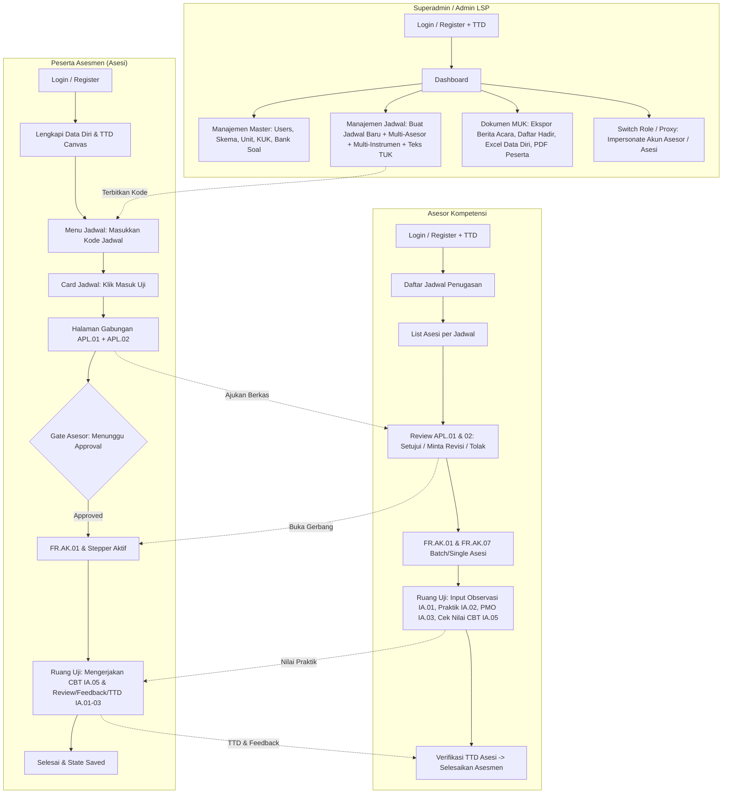
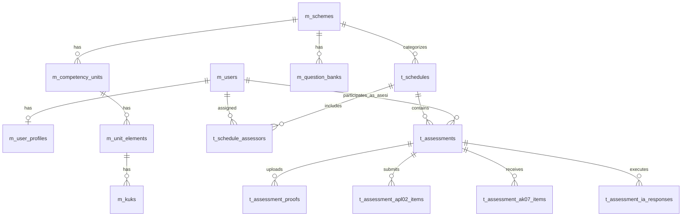

# ARSITEKTUR SISTEM DAN SPESIFIKASI FITUR (SPECIFICATION DOCUMENT)
## DIGITALISASI PROSES ASESMEN KOMPETENSI LSP PrO INDO

**Dokumen Standar:** `system_architecture_and_spec.md`  
**Stack Teknologi:** Laravel 12, Blade Engine, Tailwind CSS, Alpine.js / Vanilla JS (Zero-Bloat), MySQL/SQLite  

---

## 1. Goal (Tujuan Proyek)
Membangun web application monolitik yang *lean*, *clean-code*, dan berkinerja tinggi untuk mendigitalisasi proses sertifikasi kompetensi profesi di **LSP PrO Indo** secara menyeluruh (Asesi, Asesor, dan Admin/Superadmin). Sistem mengeliminasi proses manual berbasis kertas, menyediakan pengujian teori CBT otomatis, pencatatan observasi praktik langsung di Tempat Uji Kompetensi (TUK), pelacakan progres dengan pemulihan sesi (*state restoration*), validasi gerbang asesmen (*approval gate*), serta integrasi pusat ekspor dokumen MUK berstandar BNSP.

---

## 2. Existing State & Inventory Analisis

### 2.1 Kondisi Repositori Saat Ini
- Folder dokumen master: [`all-document-lsp-ProIndo`](file:///all-document-lsp-ProIndo) berisi 7 skema MUK lengkap (FR.APL, FR.MAPA, FR.AK, FR.IA, Berita Acara, dan Daftar Hadir).
- Status: **Aplikasi MVP Selesai & Teruji** (Role Admin, Asesor, Asesi, dan 24 template cetak MUK terverifikasi).

### 2.2 Pola yang Diadopsi (Inspirasi & Lessons Learned)
- **Anti-Bloat:** Mengurangi arsitektur yang berlebihan. Menghilangkan peran pihak luar yang tidak relevan (TUK Admin terpisah & Komite Teknis dihilangkan; fungsi TUK ditangani sebagai lokasi teks di jadwal, dan fungsi komite disederhanakan).
- **Format Bersih & Standar BNSP:** Mempertahankan keaslian formulir BNSP (APL.01, APL.02, AK.01, AK.07, IA.01, IA.02, IA.03, IA.05).
- **Keamanan & Konsistensi Tanda Tangan:** Tanda tangan digital hanya direkam dan ditampilkan jika peristiwa asesmen benar-benar terjadi.

---

## 3. Arsitektur Peran & Alur Pengguna (User Roles & Flows)



### 3.1 Alur Asesi (Candidate Flow)
1. **Registrasi / Login:** Menggunakan akun mandiri (email + password).
2. **Pengisian Data Diri:** Wajib dilengkapi sebelum mengakses jadwal. Mengisi biodata lengkap (Nama, NIK, TTL, Jenis Kelamin, Kebangsaan, Alamat, Pendidikan, Pekerjaan/Institusi) serta menggambar tanda tangan pada **Drawable Signature Component** (HTML5 Canvas).
3. **Menu Jadwal & Input Kode Jadwal:**
   - Memasukkan kode jadwal (misal: `LSP-K9P2`) yang diberikan oleh Admin/Sekolah.
   - Jadwal langsung muncul di daftar jadwal aktif asesi dengan rincian (Skema, TUK, Tanggal, Jam, Asesor).
   - Terdapat tombol `[Masuk Jadwal Uji]`.
4. **Halaman Gabungan APL (APL.01 + APL.02 dalam Satu Halaman):**
   - **Bagian Atas (APL.01):** Data diri otomatis terisi (*auto-fetch*) dari profil.
   - **Bagian Upload Bukti APL.01:**
     - *Bukti Persyaratan Dasar (Minimal 1 dari 4 opsi):* Ijazah SMK Otomotif / Surat Ket Siswa Aktif / Ijazah SMA + Sertifikat Pelatihan / Surat Pengalaman Kerja.
     - *Bukti Administratif (Wajib Keduanya):* Fotokopi KTP dan Pas Foto 3x4 (latar merah).
   - **Bagian Bawah (APL.02 Asesmen Mandiri):**
     - Tabel responsif yang bersih dan tidak *bloated*.
     - Tombol cepat di atas tabel: `[Set Semua K]` dan `[Set Semua BK]`.
     - Selector default bukti di samping tombol cepat untuk mengisi seluruh KUK secara instan.
     - Baris per KUK: Kolom Teks KUK, Opsi Radio `K` / `BK`, dan Dropdown Pilihan Bukti (hanya memunculkan bukti yang sudah diunggah oleh asesi pada APL.01 di atas).
   - **Bagian Bawah Halaman:** Tanda tangan asesi tampil otomatis dari profil (dengan opsi gambar ulang jika perlu) dan tombol `[Simpan & Lanjutkan]`.
5. **Gate Pembatas (Waiting Gate G-1):**
   - Setelah APL disubmit, asesi berada dalam status `MENUNGGU VERIFIKASI ASESOR`.
   - Asesi belum bisa lanjut ke step berikutnya sebelum asesor menyetujui.
   - Jika asesor meminta revisi, muncul catatan revisi dan form APL dapat diedit kembali.
6. **FR.AK.01 & Stepper Aktif:**
   - Stepper vertikal dinamis (sesuai Gambar 1) mulai aktif menampilkan urutan instrumen.
   - Asesi menyetujui perjanjian asesmen dan kerahasiaan (**FR.AK.01**).
7. **Ruang Uji (Assessment Room):**
   - Menampilkan hub tombol navigasi ke instrumen yang diaktifkan Admin:
     - **FR.IA.05 (CBT Ujian Pilihan Ganda):** Asesi mengerjakan soal teori interaktif secara langsung. Sistem melakukan autograding saat disubmit.
     - **FR.IA.01 (Observasi Praktik), FR.IA.02 (Tugas Demonstrasi), FR.IA.03 (PMO):** Asesi **hanya melihat (*view only*)** penilaian yang telah diinput asesor, mengisi kolom **Umpan Balik (Feedback)**, dan membubuhkan **Tanda Tangan digital persetujuan**.
8. **State Restoration (Auto-Resume):**
   - Kapan pun asesi menutup browser atau kembali ke dashboard, tombol pada jadwal akan bertuliskan `[Lanjutkan Asesmen]`. Mengkliknya akan mengarahkan asesi persis ke instrumen terakhir yang sedang aktif.

---

### 3.2 Alur Asesor (Assessor Flow)
1. **Login & Signature Setup:** Asesor login dan melengkapi tanda tangan profil.
2. **Menu Jadwal:** Menampilkan seluruh jadwal di mana asesor tersebut ditugaskan.
3. **List Asesi dalam Jadwal:**
   - Menampilkan tabel peserta yang terdaftar pada jadwal tersebut.
   - Terdapat tombol `[Review APL]` di samping nama setiap asesi.
4. **Verifikasi APL.01 & APL.02:**
   - Asesor memeriksa kesesuaian dokumen bukti dasar, administratif, dan asesmen mandiri.
   - Tiga aksi keputusan:
     - `[Setujui]`: Membuka gate bagi asesi untuk lanjut ke AK.01 dan Ruang Uji.
     - `[Minta Revisi]`: Asesor memasukkan catatan revisi (muncul di layar asesi).
     - `[Tolak]`: Menolak keikutsertaan asesi.
5. **FR.AK.01 & FR.AK.07 (Penyesuaian Wajar):**
   - Halaman **FR.AK.07** dilengkapi selector peserta (bisa memilih satu asesi atau **mencentang banyak asesi sekaligus / batch**) untuk menerapkan penyesuaian asesmen yang wajar jika ada kondisi khusus.
6. **Ruang Uji Asesor:**
   - Asesor membuka hub instrumen FR.IA:
     - **FR.IA.01 (Ceklis Observasi Praktik):** Mengisi ceklis kompetensi elemen/KUK saat mengamati asesi praktik di bengkel.
     - **FR.IA.02 (Tugas Demonstrasi):** Menilai instruksi demonstrasi kerja asesi.
     - **FR.IA.03 (Pertanyaan PMO):** Mengajukan pertanyaan klarifikasi lisan dan mencatat hasil jawaban asesi.
     - **FR.IA.05 (Review CBT):** Melihat rekap skor hasil ujian teori asesi yang sudah dinilai otomatis oleh sistem.
7. **Finalisasi Asesmen:**
   - Setelah seluruh instrumen dinilai dan telah ditandatangani oleh asesi terkait, asesor menekan tombol `[Selesaikan Asesmen]`.
   - Status jadwal diperbarui menjadi `SELESAI (FINISHED)`.

---

### 3.3 Alur Superadmin / Admin LSP (Admin Flow)
1. **Login & Signature Setup:** Admin melengkapi identitas dan tanda tangan profil.
2. **Manajemen Master Data (Superadmin):**
   - **Manajemen Pengguna:** Kelola akun (Asesi, Asesor, Admin), aktifkan/nonaktifkan akun.
   - **Manajemen Skema & Unit:** Kelola 7 skema otomotif, unit kompetensi, elemen, KUK, serta bank soal CBT.
3. **Manajemen Jadwal (Sesuai Referensi Gambar dengan Penyesuaian):**
   - **Nama Jadwal:** Input teks bebas (opsional).
   - **Skema Sertifikasi (\*):** Dropdown skema.
   - **TUK (\*):** **Input teks manual** (nama sekolah/bengkel tanpa dropdown kaku).
   - **Asesor Bertugas (\*):** Multi-select daftar asesor. *(Field Asesor Lead dihilangkan)*.
   - **Daftar Instrumen Terpilih (\*):** Multi-select instrumen (misal: `FR.AK.01`, `FR.AK.07`, `FR.IA.01`, `FR.IA.02`, `FR.IA.03`, `FR.IA.05`).
   - **Tanggal, Jam Mulai, Jam Selesai:** Date/time picker dengan kalkulasi otomatis durasi menit.
   - **Kode Verifikasi Jadwal (\*):** Input teks kode + tombol `[Generate]`.
   - **Catatan (Opsional):** Textarea catatan tambahan.
4. **Pusat Dokumen MUK (Hierarchical Accordion Center):**
   - Menampilkan daftar jadwal. Di setiap baris jadwal terdapat:
     - `[Cetak Sertifikat]`
     - `[Ekspor Berita Acara (BA)]`
     - `[Ekspor Daftar Hadir Asesor]`
     - `[Ekspor Daftar Hadir Asesi]`
     - `[Ekspor Excel Data Diri Peserta]`
   - **Expand/Dropdown Jadwal:** Membuka daftar seluruh asesi yang ikut pada jadwal tersebut.
   - **Expand/Dropdown Asesi:** Membuka tombol ekspor berkas PDF individu asesi (`APL.01`, `APL.02`, `MAPA`, `AK.01`, `Paket Lengkap`). Template PDF standar disiapkan untuk dihubungkan ke pengisian data dinamis.
5. **Switch Role / Proxy (Impersonation):**
   - Daftar seluruh akun aktif Asesor dan Asesi.
   - Tombol `[Masuk Sebagai Pengguna Ini (Proxy)]` untuk beralih instan tanpa perlu mengetahui kata sandi mereka.
   - Bar mengambang (*floating alert*) di bagian atas: Memberikan informasi akun yang sedang ditiru dan tombol `[Kembali ke Admin LSP]`.

---

## 4. Rancang Bangun Database (Data Model & Schema)

> [!NOTE] Rebaseline Migrasi & Konvensi Skema
> Seluruh skema database telah direbaseline menjadi migrasi bersih terkelompok per domain (tanpa file parsial add_xxx).
> Database yang sebelumnya dimigrasi dengan migrasi lama wajib menjalankan `php artisan migrate:fresh --seed`.
> Konvensi ke depan: satu file per perubahan skema bermakna, dilarang mengedit migrasi yang sudah dirilis.

Struktur tabel dirancang efisien, terindeks dengan baik, dan menghindari redundansi (*zero bloat*):



### Detail Skema Tabel:

#### 1. `m_users`
- `id` (BIGINT, PK, Auto Increment)
- `name` (VARCHAR 255)
- `email` (VARCHAR 255, Unique)
- `password` (VARCHAR 255)
- `role` (ENUM: `SUPERADMIN`, `ADMIN_LSP`, `ASESOR`, `ASESI`)
- `phone` (VARCHAR 30, Nullable)
- `is_active` (BOOLEAN, Default: `true`)
- `remember_token` (VARCHAR 100, Nullable)
- `timestamps`

#### 2. `m_user_profiles`
- `id` (BIGINT, PK)
- `user_id` (BIGINT, FK -> `m_users.id`, Unique)
- `nik` (VARCHAR 20, Nullable)
- `tempat_lahir` (VARCHAR 100, Nullable)
- `tanggal_lahir` (DATE, Nullable)
- `jenis_kelamin` (ENUM: `L`, `P`, Nullable)
- `kebangsaan` (VARCHAR 50, Default: `Indonesia`)
- `alamat_rumah` (TEXT, Nullable)
- `kode_pos` (VARCHAR 10, Nullable)
- `pendidikan_terakhir` (VARCHAR 50, Nullable)
- `nama_institusi` (VARCHAR 255, Nullable)
- `jabatan` (VARCHAR 100, Nullable)
- `alamat_kantor` (TEXT, Nullable)
- `signature_data` (LONGTEXT, Base64 PNG, Nullable)
- `timestamps`

#### 3. `m_schemes`
- `id` (BIGINT, PK)
- `code` (VARCHAR 50, Unique, misal `SKM-01-2026`)
- `name` (VARCHAR 255, misal `Engine Junior Technician`)
- `scheme_type` (ENUM: `OKUPASI`, `KLASTER`, `KKNI`)
- `version` (VARCHAR 20, Default: `1.0`)
- `description` (TEXT, Nullable)
- `passing_grade_theory` (DECIMAL 5,2, Default: `75.00`)
- `is_active` (BOOLEAN, Default: `true`)
- `timestamps`

#### 4. `m_competency_units`
- `id` (BIGINT, PK)
- `scheme_id` (BIGINT, FK -> `m_schemes.id`)
- `code` (VARCHAR 50, misal `G.45OTO01.001.2`)
- `title` (VARCHAR 255)
- `standard_reference` (VARCHAR 100, misal `SKKNI Nomor 97 Tahun 2018`)
- `sequence` (INT, Default: 1)
- `timestamps`

#### 5. `m_unit_elements`
- `id` (BIGINT, PK)
- `competency_unit_id` (BIGINT, FK -> `m_competency_units.id`)
- `title` (TEXT)
- `sequence` (INT, Default: 1)
- `timestamps`

#### 6. `m_kuks`
- `id` (BIGINT, PK)
- `unit_element_id` (BIGINT, FK -> `m_unit_elements.id`)
- `code_number` (VARCHAR 20, misal `1.1`, `1.2`)
- `statement` (TEXT, misal `Potensi bahaya pada area kerja diidentifikasi`)
- `sequence` (INT, Default: 1)
- `timestamps`

#### 7. `m_question_banks` (Bank Soal CBT IA.05)
- `id` (BIGINT, PK)
- `scheme_id` (BIGINT, FK -> `m_schemes.id`)
- `competency_unit_id` (BIGINT, FK -> `m_competency_units.id`, Nullable)
- `question_text` (TEXT)
- `question_image` (VARCHAR 255, Nullable)
- `option_a` (TEXT)
- `option_b` (TEXT)
- `option_c` (TEXT)
- `option_d` (TEXT)
- `correct_answer` (ENUM: `A`, `B`, `C`, `D`)
- `timestamps`

#### 8. `t_schedules`
- `id` (BIGINT, PK)
- `code` (VARCHAR 50, Unique, misal `LSP-K9P2`)
- `name` (VARCHAR 255, Nullable)
- `scheme_id` (BIGINT, FK -> `m_schemes.id`)
- `tuk_name` (VARCHAR 255) — *Input teks manual/lokasi*
- `date` (DATE)
- `start_time` (TIME)
- `end_time` (TIME)
- `duration_minutes` (INT)
- `selected_instruments` (JSON) — `["AK01", "AK07", "IA01", "IA02", "IA03", "IA05"]`
- `notes` (TEXT, Nullable)
- `status` (ENUM: `DRAFT`, `ACTIVE`, `FINISHED`, Default: `ACTIVE`)
- `created_by` (BIGINT, FK -> `m_users.id`)
- `timestamps`

#### 9. `t_schedule_assessors`
- `id` (BIGINT, PK)
- `schedule_id` (BIGINT, FK -> `t_schedules.id`, Cascade Delete)
- `assessor_id` (BIGINT, FK -> `m_users.id`, Cascade Delete)
- `timestamps`

#### 10. `t_assessments`
- `id` (BIGINT, PK)
- `schedule_id` (BIGINT, FK -> `t_schedules.id`)
- `asesi_id` (BIGINT, FK -> `m_users.id`)
- `assessor_id` (BIGINT, FK -> `m_users.id`, Nullable)
- `apl_status` (ENUM: `DRAFT`, `SUBMITTED`, `REVISION_REQUESTED`, `APPROVED`, `REJECTED`, Default: `DRAFT`)
- `apl_revision_notes` (TEXT, Nullable)
- `last_active_step` (VARCHAR 50, Default: `apl`) — *Menyimpan posisi URL/step untuk state restoration*
- `status` (ENUM: `IN_PROGRESS`, `COMPLETED`, Default: `IN_PROGRESS`)
- `registered_at` (TIMESTAMP, Nullable)
- `approved_at` (TIMESTAMP, Nullable)
- `completed_at` (TIMESTAMP, Nullable)
- `timestamps`

#### 11. `t_assessment_proofs` (Upload Berkas APL.01)
- `id` (BIGINT, PK)
- `assessment_id` (BIGINT, FK -> `t_assessments.id`)
- `proof_type` (ENUM: `IJAZAH_SMK`, `SURAT_SISWA_AKTIF`, `IJAZAH_SMA_SERTIFIKAT`, `PENGALAMAN_KERJA`, `KTP`, `PAS_FOTO`)
- `proof_category` (ENUM: `PERSYARATAN_DASAR`, `ADMINISTRATIF`)
- `file_path` (VARCHAR 255)
- `original_filename` (VARCHAR 255)
- `timestamps`

#### 12. `t_assessment_apl02_items` (Tabel Simpel Asesmen Mandiri)
- `id` (BIGINT, PK)
- `assessment_id` (BIGINT, FK -> `t_assessments.id`)
- `kuk_id` (BIGINT, FK -> `m_kuks.id`)
- `assessment_value` (ENUM: `K`, `BK`)
- `selected_proof_type` (VARCHAR 50)
- `timestamps`

#### 13. `t_assessment_ak07_items` (Penyesuaian Wajar)
- `id` (BIGINT, PK)
- `assessment_id` (BIGINT, FK -> `t_assessments.id`)
- `adjustment_category` (VARCHAR 100)
- `adjustment_detail` (TEXT)
- `assessor_id` (BIGINT, FK -> `m_users.id`)
- `timestamps`

#### 14. `t_assessment_ia_responses` (Jawaban, Observasi, Skor & TTD)
- `id` (BIGINT, PK)
- `assessment_id` (BIGINT, FK -> `t_assessments.id`)
- `instrument_code` (ENUM: `IA01`, `IA02`, `IA03`, `IA05`)
- `data_json` (LONGTEXT, JSON nilai observasi / jawaban CBT)
- `score` (DECIMAL 5,2, Nullable — untuk IA.05)
- `assessor_notes` (TEXT, Nullable)
- `asesi_feedback` (TEXT, Nullable — umpan balik asesi)
- `assessor_signed_at` (TIMESTAMP, Nullable)
- `asesi_signed_at` (TIMESTAMP, Nullable)
- `timestamps`

---

## 5. Rencana File & Struktur Kode (Directory Architecture)

```
app/
├── Http/
│   ├── Controllers/
│   │   ├── Auth/
│   │   │   └── AuthController.php            # Login, register, logout, proxy switch back
│   │   ├── Asesi/
│   │   │   ├── ProfileController.php         # Data diri & tanda tangan canvas
│   │   │   ├── JadwalController.php          # Gabung jadwal via kode & list jadwal asesi
│   │   │   ├── AplController.php             # Gabungan APL.01 + APL.02 + upload bukti
│   │   │   ├── InstrumentController.php      # AK.01, Ruang Uji, IA.01-03 view/feedback/sign, IA.05 CBT
│   │   ├── Asesor/
│   │   │   ├── JadwalController.php          # Jadwal penugasan asesor & daftar asesi
│   │   │   ├── AplReviewController.php       # Verifikasi APL (Setujui, Minta Revisi, Tolak)
│   │   │   ├── Ak07Controller.php            # Penyesuaian wajar (Single & Batch asesi)
│   │   │   ├── InstrumentAssessmentController.php # Input IA.01, IA.02, IA.03 & review IA.05
│   │   │   └── FinalizationController.php    # Kunci asesmen -> Status selesai
│   │   └── Admin/
│   │       ├── DashboardController.php       # Statistik ringkas
│   │       ├── JadwalController.php          # CRUD Jadwal (TUK text, multi-asesor, instrumen)
│   │       ├── DokumenMukController.php      # Pusat dokumen (BA, Daftar Hadir, Excel, PDF asesi)
│   │       ├── ProxyController.php           # Impersonate / switch role
│   │       ├── SchemeController.php          # Master skema, unit, elemen, KUK
│   │       ├── UserController.php            # Master akun pengguna
│   │       └── QuestionBankController.php    # Master bank soal CBT
│   └── Middleware/
│       ├── RoleMiddleware.php                # Validasi guard role
│       ├── CheckAplApprovedGate.php          # Gate pembatas G-1: Cegah lanjut jika belum diapprove
│       └── TrackLastStepMiddleware.php       # Rekam step aktif untuk state restoration
├── Models/
│   ├── User.php
│   ├── UserProfile.php
│   ├── Scheme.php
│   ├── CompetencyUnit.php
│   ├── UnitElement.php
│   ├── Kuk.php
│   ├── QuestionBank.php
│   ├── Schedule.php
│   ├── Assessment.php
│   ├── AssessmentProof.php
│   ├── AssessmentApl02Item.php
│   ├── AssessmentAk07Item.php
│   └── AssessmentIaResponse.php
└── Services/
    ├── AutoGradeService.php                  # Engine koreksi otomatis FR.IA.05 CBT
    └── MukExportService.php                  # Generator ekspor BA, Daftar Hadir, Excel & PDF
```

---

## 6. Edge Cases & Validations (Kasus Kritis & Penanganannya)

1. **Validasi Bukti Kelengkapan Pemohon APL.01:**
   - *Syarat Dasar:* Harus ada minimal 1 file di antara 4 opsi bukti persyaratan dasar. Jika 0, form menolak submit dengan pesan validasi ramah.
   - *Syarat Administratif:* File KTP dan Pas Foto 3x4 wajib terunggah keduanya.
2. **Gate G-1 (Approval Gate):**
   - URL `/asesi/jadwal/{id}/ak01` dan instrumen setelahnya dilindungi oleh `CheckAplApprovedGate`. Jika asesi mencoba *bypass* via pengetikan URL langsung saat status masih `DRAFT` atau `SUBMITTED`, sistem otomatis me-*redirect* kembali ke halaman APL dengan pesan "Menunggu persetujuan asesor".
3. **Minta Revisi Flow:**
   - Jika asesor menekan `[Minta Revisi]`, field catatan revisi wajib diisi. Status berubah menjadi `REVISION_REQUESTED`.
   - Di dashboard asesi muncul banner peringatan oranye beserta catatan asesor. Form APL.01 dan APL.02 terbuka kembali untuk perbaikan.
4. **State Restoration & Auto-Resume:**
   - Setiap kali asesi berpindah step di Ruang Uji, kolom `last_active_step` diupdate.
   - Saat asesi login kembali dan mengklik `[Lanjutkan Asesmen]`, controller langsung melakukan *redirect* ke route instrumen yang tersimpan.
5. **Autograding FR.IA.05 (CBT):**
   - Jawaban asesi dicocokkan dengan kunci `correct_answer`. Skor persentase dihitung otomatis (`(jawaban_benar / total_soal) * 100`). Status lulus jika `>= 75.00`.
6. **Keamanan Proxy / Impersonation:**
   - ID admin asli disimpan di session `admin_impersonator_id`.
   - Asesor/Asesi yang sedang di-impersonate tidak dapat mengakses menu admin.
   - Tombol "Kembali ke Admin" langsung meregenerasi sesi admin asli.

---

## 7. Out of Scope (Hal yang Dieliminasi Demi Clean Code / Anti-Bloat)
- Menghilangkan modul e-sertifikat bertanda QR code dinamis yang berbelit (diganti tombol ekspor template sertifikat).
- Menghilangkan peran pihak ketiga terpisah (TUK Admin & Komite Teknis).
- Menghilangkan pengisian form APL manual via impor berkas Excel massal dari sekolah (seluruh asesi mendaftar mandiri via kode jadwal).
- Menghilangkan verifikasi akun menggunakan OTP email (menggunakan password langsung).

---

## 8. Regression Test Plan

### 8.1 Baseline
- Repositori awal: Greenfield project (`lsp-proindo-new`).
- Tidak ada tes lama yang berisiko regresi di direktori ini.

### 8.2 Rangkaian Pengujian Otomatis yang Akan Dibuat:
1. **`AuthAndProxyTest`**:
   - Pengujian register, login, profil biodata, dan tanda tangan digital.
   - Pengujian Admin impersonating ke Asesi/Asesor dan kembali ke Admin.
2. **`ScheduleCreationTest`**:
   - Admin membuat jadwal dengan input teks TUK, penugasan multi-asesor, multi-select instrumen, dan kode unik.
3. **`AsesiRegistrationAndAplTest`**:
   - Asesi input kode jadwal dan masuk daftar peserta.
   - Validasi bukti persyaratan dasar (minimal 1) dan administratif (keduanya).
   - Pengisian tabel APL.02 (fitur bulk Semua K/BK dan dropdown bukti).
4. **`AsesorApprovalGateTest`**:
   - Memastikan asesi terblokir masuk ke AK.01 jika status masih `SUBMITTED`.
   - Menguji aksi Minta Revisi (catatan revisi) dan Setujui.
5. **`Ak07BatchAssignmentTest`**:
   - Asesor menerapkan penyesuaian wajar secara individu maupun batch ke beberapa asesi.
6. **`AssessmentExecutionAndCbtTest`**:
   - Asesor mengisi observasi IA.01, tugas IA.02, pertanyaan IA.03.
   - Asesi mengerjakan CBT IA.05 dan autograder menghitung skor dengan benar.
   - Asesi memberikan umpan balik dan menandatangani hasil IA.01-03.
7. **`StateRestorationTest`**:
   - Asesi keluar di tengah Ruang Uji dan saat kembali otomatis di-resume ke halaman terakhir.
8. **`DokumenMukExportTest`**:
   - Pengujian ketersediaan rute unduh Berita Acara, Daftar Hadir, Excel Data Diri, dan PDF peserta.

---

## 9. Alur Kerja Git & Standar Kolaborasi
- **Model Percabangan:** Menggunakan 2 branch permanen: `main` (rilis stabil) dan `develop` (pengembangan aktif).
- **Fitur & Perbaikan:** Branch fitur berumur pendek dibuat dari `develop` dengan prefix `feat/`, `fix/`, atau `chore/` lalu di-merge kembali ke `develop`.
- **Rilis Produksi:** Penggabungan dari `develop` ke `main` hanya dilakukan saat rilis versi stabil disertai pembuatan tag semver (mis. `v1.0.0`).
- **Konvensi Pesan Commit:** Wajib mematuhi format Conventional Commits (`feat:`, `fix:`, `chore:`, `docs:`, `test:`).
- **Integritas Riwayat:** Dilarang keras melakukan force-push (`git push --force`) ke branch `main` maupun `develop`.
